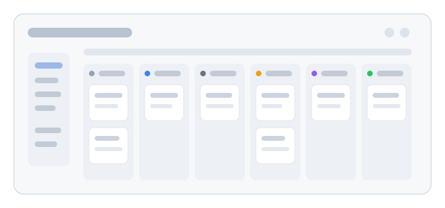
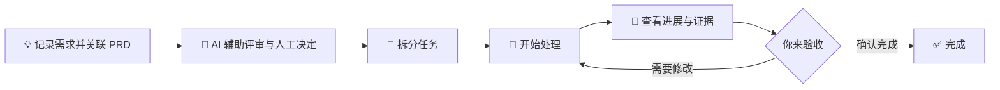

# 项目工作台

**在 DeepSeek Harness 里管理需求、任务和验收，让 AI 的每一步都有记录，最后由你决定是否完成。**



> [!NOTE]
> 本指南适用于项目工作台 `0.1.4`。插件要求 DeepSeek Harness `0.2.2-rc.3` 或更新版本，建议使用 Desktop `0.2.2-rc.5` 或更新版本。

## 它能帮你做什么

- 📋 **记录和评审需求**。在需求详情关联 PRD、发起 AI 辅助评审并查看报告，由你决定是否进入开发。
- 🕒 **从日志追溯动态**。在需求详情查看需求流转和下属任务的变化，点开对应的报告、决定或任务。
- 🗂️ **管理任务**：把需求拆成任务，在看板上查看进度、阻塞和风险。
- 🤖 **让 AI 处理任务**：你可以从会话或工作台发起任务处理。
- 🔍 **查看真实进展**：文件修改、运行命令和检查结果会记录到对应任务。
- ✅ **由你验收**：核对完成标准和验证依据后，再确认任务或需求完成。
- 📚 **生成项目资料**：按需生成 Wiki 和源码架构图，也可以只提交 `.project/` 数据到 Git。

## 安装

### 在桌面版中添加（推荐）

1. 下载并解压 `dsh-project-workbench-0.1.4.zip`。[下载 0.1.4 安装包](https://github.com/Vincent-chk/dsh-project-workbench/releases/download/v0.1.4/dsh-project-workbench-0.1.4.zip)
2. 在 DeepSeek Harness 左侧打开 **插件 → 添加插件**，选择解压后直接包含 `package.json` 的 `dsh-project-workbench` 文件夹。
3. 安装完成后，在 **插件 → 已安装** 中打开 **项目工作台** 的启用开关。
4. 在 DSH 左侧点击 **项目工作台**。如果左侧入口暂未出现，重启 DSH 后再打开。

安装包已包含运行所需文件，解压后即可添加。升级时，先在 **插件 → 已安装 → 项目工作台** 卸载同名旧版，再按上面步骤安装。需求、PRD 和评审记录保存在各工作区的 `.project/` 中，重新打开原工作区即可接着使用。

### 使用 DSH CLI

如果你已用 DSH CLI 管理插件，可按配置安装固定版本。下面以 `desktop` 配置为例。

```sh
dsh plugin --profile desktop add 'github:Vincent-chk/dsh-project-workbench#v0.1.4'
```

## 第一次打开项目工作台

1. 在左侧打开 **项目工作台**，选择你要管理的工作区。首次使用该工作区时，点击 **启用项目管理**。
2. 进入 **需求池 → 新建需求**，填写标题和需求概述并保存。
3. 在 **需求池** 点击需求标题即可打开需求详情。也可以从 **看板** 点击同一张需求卡片进入。

## 需求详情与日志

需求详情有七个板块。**基本信息**固定在最上方，**日志**固定在最下方。中间是**关联 PRD、评审记录、下属任务、开发记录、交付与验收**。点击各板块标题可展开或收起。不同阶段会优先展开当前需要看的内容。

- **调整布局**。在页首打开 **更多选项 → 调整板块顺序**，拖动中间五个板块或使用上移、下移按钮，点击 **完成**。顺序只保存在本机的这条需求上。
- **查看日志**。滚到需求详情底部，点击 **日志**。这里按时间倒序展示送审、报告保存、人工评审、任务状态变化和验收动态。点击带链接的条目，可打开对应报告、人工决定或任务详情。
- **记录开发过程**。在 **开发记录** 点击 **记录进展**，补充实际工作或验证情况。任务自身的进展和验证依据也可从 **下属任务** 点击任务标题查看。

## AI 辅助评审

1. 在待送审的需求详情展开 **关联 PRD**。点击 **新建 PRD** 并保存，或从 **选择 PRD** 选一份已保存的文档，点击 **保存关联**。
2. 打开 **看板**，将需求从 **需求池** 拖到 **评审中**。随后在看板点击需求卡片，或从 **需求评审** 列表打开它。
3. 在 **评审记录** 点击 **AI 辅助评审**。报告生成并保存后，展开 **第 1 次评审**，阅读建议以及本轮所用的需求和 PRD 版本。在页面底部的 **日志** 也能打开这份报告。
4. 如需在修改资料后重新核对，点击 **再次评审**。每次成功保存的报告都有自己的轮次。页面提示资料已更新时，可以核对旧报告所用版本。
5. 确认有一份基于仍关联 PRD 的正式报告后，点击 **通过评审** 将需求移到 **待开发**。需要退回时，点击 **驳回需求** 并填写理由，需求会回到 **需求池**。

### 从开发到验收

准备好后，把需求从 **待开发** 拖到 **开发中**。在需求详情的 **下属任务** 新建任务并填写完成标准。点击 **开始处理** 发起任务执行，再核对结果和验证依据。



只看页面、切换项目或关联任务，**不会自动让 AI 开始处理**。

## 在会话中使用工作台

在 DSH 聊天框输入 `/pwb`，从原生命令菜单选择操作。也可以选择 `@` 菜单的「项目工作台」，或在消息开头输入 `@workbench` 后用自然语言说明要做的事。发送后，工作台以当前会话所在的工作区为准。AI 追问同一件事时，可以直接回答。说「先别记」或「取消」可以结束跟进。

| 命令 | 用途 |
| --- | --- |
| `/pwb-help` | 查看操作和用法，可询问当前任务为何不能开始 |
| `/pwb-requirement` | 查找、记录、完善、移除或恢复需求草稿 |
| `/pwb-task` | 建议拆分、新建、开始、记录结果、提交或核对验收 |
| `/pwb-update` | 把当前会话的新进展和已确认决定记到关联任务的进展记录，也可指定需求或任务 |
| `/pwb-prd` | 从已有需求生成 PRD 草稿，或更新一份已有 PRD |
| `/pwb-wiki-update` | 按现有 Git 条件生成或更新 Wiki，可带「查看进度」 |
| `/pwb-architecture-update` | 用本地源码更新架构图，可带「查看进度」 |
| `/pwb-status` | 查看项目进展、阻塞和待确认事项 |

例如 `@workbench 帮我记一个需求：做一个可切换 AI 风格的本地聊天网页`。草稿写入需求池后，直接回答 AI 的追问就能补充原需求。验收通过仍在工作台内确认。PRD 可以在会话里编辑，确认后保存在项目的 `.project/prds/`。在需求详情展开「关联 PRD」可边看需求边读文档，也可以在「项目资料 → PRD 管理」查阅、编辑或恢复文档。正文支持 Markdown 表格和本地图片，每份文档只保存最新版。

## 主工作台和会话右栏

| 位置 | 适合做什么 |
| --- | --- |
| 左侧 **项目工作台** | 查看所有需求和任务、拖动看板、处理评审与验收、生成 Wiki 和架构图 |
| 会话右侧 **工作台** | 专注当前任务，开始或继续处理，查看最新进展，核对并确认结果 |

需求依次经过：**需求池 → 评审中 → 待开发 → 开发中 → 待验收 → 已完成**。

AI 可以整理需求、建议任务拆分和汇总交付内容，但这些建议会先交给你核对；任务完成、取消、评审和验收通过仍由你在界面中决定。

## 数据保存在哪里

项目数据默认保存在对应工作区的 `.project/` 文件夹中：

- 需求、任务、PRD、评审报告、进展和验收记录使用 Markdown 文件保存。
- `.project/.local/` 保存会话关联、运行锁和内部备份，不需要手动编辑。
- 禁用或卸载插件**不会删除这些项目文件**。
- AI 辅助评审、Wiki、架构图、需求整理和交付摘要会使用你当前配置的模型。评审会把相关需求、PRD 内容和少量项目背景发送给模型服务并消耗模型额度。

## 注意事项

- AI 的总结和建议可能有误，请结合页面中的实际命令、输出和文件变化判断。
- Wiki 生成须在 Git 仓库顶层执行，零次提交也可使用。暂不支持包含符号链接、子模块、Git worktree 或部分特殊索引的项目。
- 架构图基于当前工作区可读取的源码生成，普通目录也支持。
- 测试命令可能访问外部服务或改变测试环境，请先核对任务范围。
- 遇到问题或有功能建议，欢迎到 [GitHub Issues](https://github.com/Vincent-chk/dsh-project-workbench/issues) 反馈。

## 开发者检查

普通使用者可以忽略这一部分。修改源码后，在仓库根目录运行：

```sh
npm install
npm run build
npm run check
npm test
```

`client-src/` 是客户端源码，`client.js` 是插件实际加载的构建产物；修改客户端源码后需要重新构建。

## 许可证

[MIT](LICENSE)。第三方组件说明见 [THIRD_PARTY_NOTICES.md](THIRD_PARTY_NOTICES.md)。
