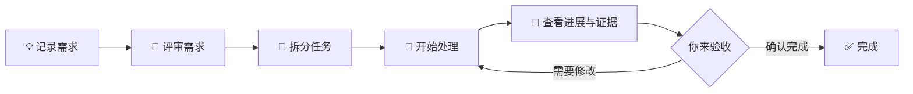

# 项目工作台

**在 DeepSeek Harness 里管理需求、任务和验收，让 AI 的每一步都有记录，最后由你决定是否完成。**


> [!NOTE]
> 当前为早期预览版。会话命令支持 DeepSeek Harness `0.2.2-rc.3` 起的版本，建议使用 Desktop `0.2.2-rc.5` 或更新版本。

## 它能帮你做什么

- 📋 **记录需求**：把想法写清楚，再经过评审进入开发。
- 🗂️ **管理任务**：把需求拆成任务，在看板上查看进度、阻塞和风险。
- 🤖 **让 AI 处理任务**：你可以从会话或工作台发起任务处理。
- 🔍 **查看真实进展**：文件修改、运行命令和检查结果会记录到对应任务。
- ✅ **由你验收**：核对完成标准和验证依据后，再确认任务或需求完成。
- 📚 **生成项目资料**：按需生成 Wiki 和源码架构图，也可以只提交 `.project/` 数据到 Git。

## 安装

### 方法一：在桌面版中添加（推荐）

1. 从 [GitHub Releases](https://github.com/Vincent-chk/dsh-project-workbench/releases/latest) 下载 `dsh-project-workbench-<版本>.zip` 并解压。
2. 打开 DeepSeek Harness，进入 **插件 → 添加插件**。
3. 选择解压后的文件夹。请选择直接包含 `package.json` 的那一层目录。
4. 启用 **项目工作台**。

安装包已经包含运行所需文件，**不需要安装 Node.js 依赖，也不需要执行构建命令**。

### 方法二：使用命令行

已经安装 DSH CLI 时，可以运行：

```sh
dsh plugin add github:Vincent-chk/dsh-project-workbench
```

## 快速开始

1. 点击 DSH 左侧的 **项目工作台**。
2. 选择一个工作区，点击 **启用项目管理**。
3. 新建需求并填写“要解决什么问题”。在需求详情新建或关联一份已保存的 PRD，再送审。
4. 在需求下新建任务，写清任务内容和完成标准。
5. 点击 **开始处理**。AI 完成任务后，核对结果和验证依据，再决定是否验收通过。



只看页面、切换项目或关联任务，**不会自动让 AI 开始处理**。

## 在会话中使用工作台

在 DSH 聊天框输入 `/pwb`，从原生命令菜单选择操作。也可以选择 `@` 菜单的「项目工作台」，或在消息开头输入 `@workbench` 后用自然语言说明要做的事。发送后，工作台以当前会话所在的工作区为准。AI 追问同一件事时，可以直接回答。说「先别记」或「取消」可以结束跟进。

| 命令 | 用途 |
| --- | --- |
| `/pwb-help` | 查看操作和用法，可询问当前任务为何不能开始 |
| `/pwb-requirement` | 查找、记录、完善、移除或恢复需求草稿 |
| `/pwb-task` | 建议拆分、新建、开始、记录结果、提交或核对验收 |
| `/pwb-update` | 把当前会话的新进展和已确认决定记到关联任务的进展记录，也可指定需求或任务 |
| `/pwb-prd` | 从已有需求生成 PRD 草稿，或更新一份已有 PRD |
| `/pwb-wiki-update` | 按现有 Git 条件生成或更新 Wiki，可带「查看进度」 |
| `/pwb-architecture-update` | 用本地源码更新架构图，可带「查看进度」 |
| `/pwb-status` | 查看项目进展、阻塞和待确认事项 |

例如 `@workbench 帮我记一个需求：做一个可切换 AI 风格的本地聊天网页`。草稿写入需求池后，直接回答 AI 的追问就能补充原需求。验收通过仍在工作台内确认。PRD 可以在会话里编辑，确认后保存在项目的 `.project/prds/`。在需求详情展开「关联 PRD」可边看需求边读文档，也可以在「项目资料 → PRD 管理」查阅、编辑或恢复文档。正文支持 Markdown 表格和本地图片，每份文档只保存最新版。

## 主工作台和会话右栏

| 位置 | 适合做什么 |
| --- | --- |
| 左侧 **项目工作台** | 查看所有需求和任务、拖动看板、处理评审与验收、生成 Wiki 和架构图 |
| 会话右侧 **工作台** | 专注当前任务，开始或继续处理，查看最新进展，核对并确认结果 |

需求依次经过：**需求池 → 评审中 → 待开发 → 开发中 → 待验收 → 已完成**。

AI 可以整理需求、建议任务拆分和汇总交付内容，但这些建议会先交给你核对；任务完成、取消、评审和验收通过仍由你在界面中决定。

## 数据保存在哪里

项目数据默认保存在对应工作区的 `.project/` 文件夹中：

- 需求、任务、进展和验收记录使用 Markdown 文件保存。
- `.project/.local/` 保存会话关联、运行锁和内部备份，不需要手动编辑。
- 禁用或卸载插件**不会删除这些项目文件**。
- 使用 Wiki、架构图、需求整理或交付摘要等 AI 功能时，会调用你当前配置的模型并消耗模型额度；相关内容可能发送给该模型服务。

## 注意事项

- AI 的总结和建议可能有误，请结合页面中的实际命令、输出和文件变化判断。
- Wiki 生成须在 Git 仓库顶层执行，零次提交也可使用。暂不支持包含符号链接、子模块、Git worktree 或部分特殊索引的项目。
- 架构图基于当前工作区可读取的源码生成，普通目录也支持。
- 测试命令可能访问外部服务或改变测试环境，请先核对任务范围。
- 遇到问题或有功能建议，欢迎到 [GitHub Issues](https://github.com/Vincent-chk/dsh-project-workbench/issues) 反馈。

## 开发者检查

普通使用者可以忽略这一部分。修改源码后，在仓库根目录运行：

```sh
npm install
npm run build
npm run check
npm test
```

`client-src/` 是客户端源码，`client.js` 是插件实际加载的构建产物；修改客户端源码后需要重新构建。

## 许可证

[MIT](LICENSE)。第三方组件说明见 [THIRD_PARTY_NOTICES.md](THIRD_PARTY_NOTICES.md)。
